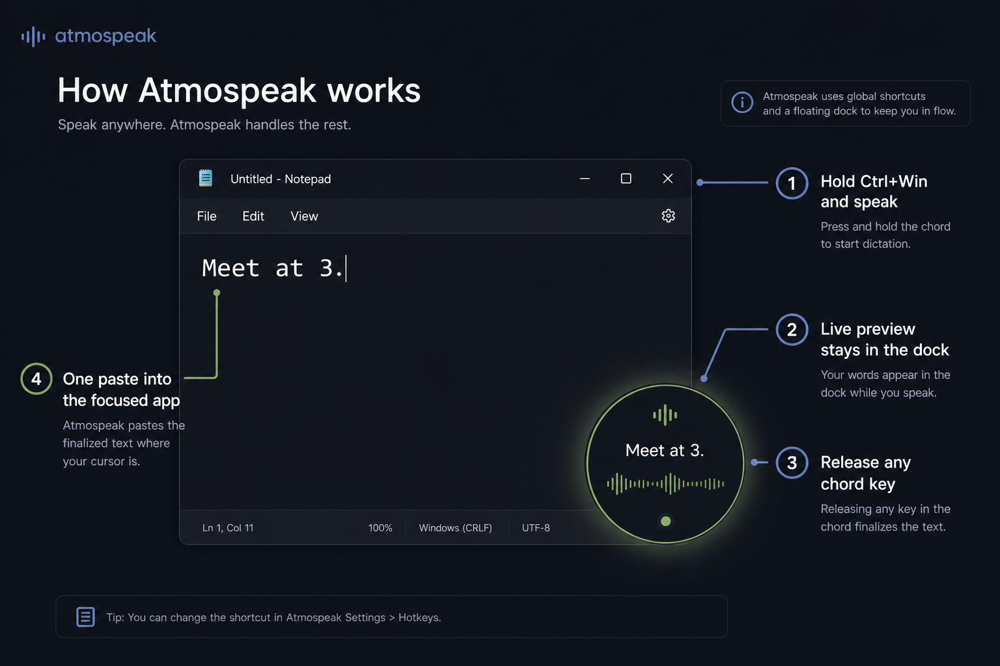
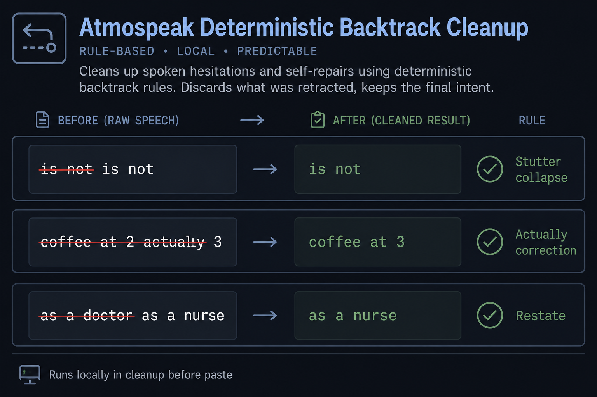
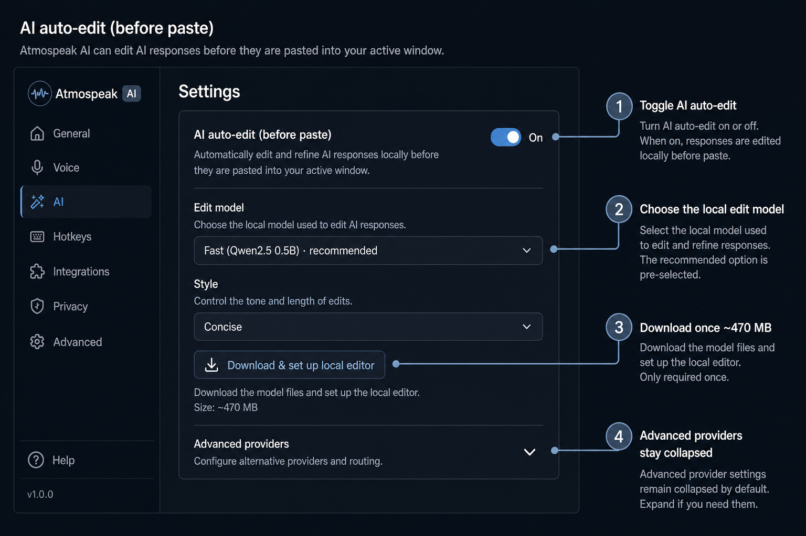
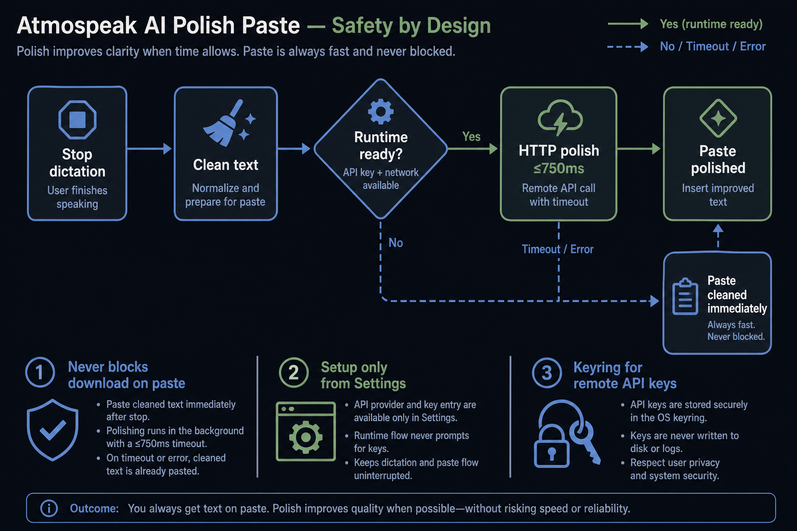
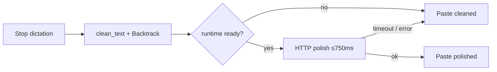
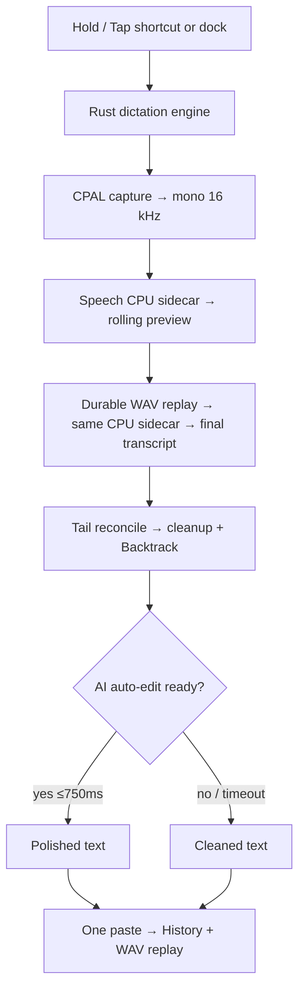

<p align="center">
  
</p>

<h1 align="center">Atmospeak</h1>

<p align="center">
  Streaming, local-first voice dictation for Windows. Speak naturally, preview locally, and paste once.
</p>

<p align="center">
  <a href="https://github.com/leviathofnoesia/atmospeak/releases/latest"></a>
  <a href="https://www.novpax.org/projects/atmospeak"></a>
  <a href="LICENSE"></a>
</p>

<p align="center">
  <a href="https://www.novpax.org/projects/atmospeak"><strong>Website</strong></a>
  ·
  <a href="https://github.com/leviathofnoesia/atmospeak/releases/tag/v1.0.5"><strong>Download v1.0.5</strong></a>
  ·
  <a href="https://github.com/leviathofnoesia/atmospeak/releases/tag/v1.0.5"><strong>Release notes</strong></a>
</p>

Atmospeak is a Windows desktop dictation app with offline English speech
recognition on the CPU. It requires no account and sends no
microphone audio to a transcription service.

## Free dictation

Free dictation is unlimited and works without an account.

- **Speak and paste.** Hold or tap your hotkey, watch the live preview in the
  dock, and get exactly one paste into whatever application had focus. The
  speech engine runs locally on the CPU and is configured for English.
- **Offline speech models.** Parakeet Unified English is the default. Settings
  lets you download and switch to speech models from the Handy catalog.
- **Control how each app receives dictation.** Set app-specific cleanup and
  writing preferences. Use Ctrl+Alt+E to edit the current text selection by voice.
- **Deterministic Backtrack.** Cleanup collapses stutters, applies
  `actually` / `I mean` / `wait no`, honors `go back` / `forget that`, and
  keeps the later ending on restates like `as a doctor…as a nurse`.
- **Optional on-device AI edit.** Toggle AI auto-edit, download a small local
  editor once (~470&nbsp;MB), and polish stays on your machine. Advanced settings
  still allow Ollama or OpenAI-compatible endpoints; API keys live in the OS
  keyring.
- **Paste never waits on setup.** If the local editor is not ready yet,
  Atmospeak pastes cleaned text immediately. Timeouts and errors fall back the
  same way.
- **Your words stay yours.** Searchable history with captured-WAV replay and
  recovery, undo / redo for AI edits, a personal dictionary, snippets,
  and local diagnostics — all on disk, on your machine.

Latest patch notes: [`docs/releases/v1.0.5.md`](docs/releases/v1.0.5.md).
The 1.0.0 product declaration remains in
[`docs/releases/v1.0.0.md`](docs/releases/v1.0.0.md).

## Install

Atmospeak currently supports **Windows 10/11 x64** (`v1.0.5`). No account or email gate required:

| Package | Direct download (`v1.0.5`) | Use it when |
| --- | --- | --- |
| Setup EXE (8.3 MB) | [atmospeak_1.0.5_x64-setup.exe](https://github.com/leviathofnoesia/atmospeak/releases/download/v1.0.5/atmospeak_1.0.5_x64-setup.exe) | Recommended single-file Windows installer |
| MSI (13.7 MB) | [atmospeak_1.0.5_x64_en-US.msi](https://github.com/leviathofnoesia/atmospeak/releases/download/v1.0.5/atmospeak_1.0.5_x64_en-US.msi) | Managed or enterprise MSI rollout |
| Portable ZIP (13.9 MB) | [atmospeak_1.0.5_x64-portable.zip](https://github.com/leviathofnoesia/atmospeak/releases/download/v1.0.5/atmospeak_1.0.5_x64-portable.zip) | Run from a folder without system install |
| Checksums | [SHA256SUMS.txt](https://github.com/leviathofnoesia/atmospeak/releases/download/v1.0.5/SHA256SUMS.txt) | Verify artifacts before launching |

**3-step setup:**
1. Download and run `atmospeak_1.0.5_x64-setup.exe`.
2. Approve Windows SmartScreen once (see below).
3. Let first-run setup download the Parakeet English speech model once. After that, hold `Ctrl+Win`, speak, and release to paste. Dictation runs on your CPU with no network.

### Windows SmartScreen & code signing transparency

The free v1.0.5 installers do **not** yet carry an Authenticode publisher signature, so Windows Defender SmartScreen may show **Windows protected your PC**:

1. Click **More info**.
2. Verify the application name is `atmospeak_1.0.5_x64-setup.exe` (or `.msi`).
3. Click **Run anyway**.

We will prioritize Windows Authenticode code signing once early Atmospeak Pro sales cover the signing certificate. In the meantime, every release is built transparently in GitHub Actions with SHA-256 verification:

```powershell
Get-FileHash "$env:USERPROFILE\Downloads\atmospeak_1.0.5_x64-setup.exe" -Algorithm SHA256
# Expected v1.0.5 setup EXE:
# 92f7367a09fd045e65526dc19ef799ee43f5051a42e7d68ea0a4870f555bfd70
```

- `atmospeak_1.0.5_x64_en-US.msi`: `0f99180569b1825a6e5a53c5203615f2fcb2a26aba9aeef3a2af62efcaeed180`
- `atmospeak_1.0.5_x64-portable.zip`: `0a7e83186c6af3aec6a42629fb84c5e1faca91722eab842f30af85686974aa89`

## Daily use

<p align="center">
  
</p>

1. Complete the six-step first-run setup and its real microphone transcription.
2. Leave Atmospeak in the tray.
3. Choose **Hold** or **Tap** in Settings.
4. In Hold mode, hold the default `Ctrl+Win` shortcut, speak, then release any
   chord key. In Tap mode, press the chord once to start and again to stop.
5. Watch the local preview in the dock while speaking. Atmospeak finalizes the
   remaining tail and pastes once at the cursor that was active when recording
   began.

Use **Settings → Profiles & editing** to override cleanup, AI polish, style,
and instructions for an executable such as `notepad.exe`. Unset options inherit
your defaults; the recording keeps the policy selected when it started.

To edit a selected passage in a supported Windows text control, select it,
press `Ctrl+Alt+E`, speak the change, and press the same shortcut again.
Uppercase/lowercase commands are immediate; other edits use the configured
local AI runtime. Keep the original selection focused until replacement.
Cancel on the floating control aborts the edit. If the selection changes,
the replacement stays in History and the target is left unchanged.

If Windows prevents a normal
process from injecting into a higher-integrity application, Atmospeak leaves
the transcript on the clipboard instead of discarding it.

Local application data lives under:

```text
%LOCALAPPDATA%\Atmospeak
```

That directory contains settings, history, downloaded AI-edit model data,
diagnostics, and the local database. Atmospeak does not require a cloud account.

## Backtrack (always on in cleanup)

<p align="center">
  
</p>

When cleanup is enabled, Atmospeak applies deterministic edits before paste:

| You said | Pasted result |
| --- | --- |
| `is not is not` | `is not` |
| `coffee at 2 actually 3` | `coffee at 3` |
| `draft one go back draft two` | `draft two` |
| `hire me as a doctor as a nurse` | `hire me as a nurse` |
| `I want coffee I want tea` | `I want tea` |

No network call is required for Backtrack.

## Optional AI auto-edit

<p align="center">
  
</p>

1. Open **Settings** and enable **AI auto-edit before paste**.
2. Pick the recommended local model (Qwen2.5 0.5B).
3. Click **Download & set up local editor** (or let the first toggle kick off
   setup in the background). Progress appears in Settings.
4. After setup completes, short dictations can polish within the 750&nbsp;ms
   auto-edit budget. History can still **Undo AI edit** / **Redo AI edit**.

Advanced provider settings stay collapsed by default. Remote OpenAI-compatible
keys are stored in the OS keyring (`atmospeak` / `polish-api-key`), with
`ATMOSPEAK_POLISH_API_KEY` or `OPENAI_API_KEY` as env fallbacks — never SQLite.

### Paste safety when polish is enabled

<p align="center">
  
</p>



Setup and downloads happen only from Settings (or the background job started
when you enable the toggle). The paste path never waits on a model download.

## Speech engine

Parakeet Unified English 0.6B Q8_0 is the default model. Download it or a
model from the Handy catalog. Settings lets you compare languages, download
sizes, and Handy's reference CPU speed and error rates. Models with live
preview transcribe as you speak. Other models transcribe from the captured
recording when you stop. Downloaded weights live in your user profile and
can be used offline. Choose Use before removing your previous model.

Optional **AI edit** model (separate from speech recognition):

| Atmospeak ID | Upstream | Availability | Approx. size |
| --- | --- | --- | ---: |
| `qwen2.5-0.5b` | Qwen2.5 0.5B Instruct GGUF | Settings → AI auto-edit | ~470 MB |

## How it works



Streaming preview and durable-WAV replay use the same selected CPU model. Audio quality checks are advisory: quiet, noisy, or clipped input can
emit a warning, but the captured WAV remains available in History and the
warning does not delete audio or abort dictation.

## Build from source

Requirements:

- Windows 10/11 x64
- Rust toolchain
- Visual Studio Build Tools with **Desktop development with C++**
- [Bun](https://bun.sh/)
- [Git LFS](https://git-lfs.com/)

```powershell
git clone https://github.com/leviathofnoesia/atmospeak.git
cd atmospeak
git lfs install
bun install

# Build the pinned CPU decoder.
powershell -ExecutionPolicy Bypass -File scripts/build-asr-sidecars.ps1 -SkipModel
bun run tauri dev
```

Use an E: checkout for native builds. The first build downloads the pinned
transcribe.cpp source. The package includes the speech sidecar, CPU backend
DLLs, and license notices.
See [Model bootstrap](docs/MODEL_BOOTSTRAP.md).

## Validate a change

```powershell
bun run build
bun run test
bun run e2e
bun run site:build
cargo test --manifest-path src-tauri/Cargo.toml
```

The native push-to-talk harness exercises shortcut persistence, key-down,
key-up, transcription, target restoration, and exactly one native paste:

```powershell
bun run validation:native-ptt
bun run validation:paste-latency
```

The deterministic audio seam exists only in debug builds. Release acceptance
still requires real microphone runs for Notepad one-shot (`001`) and
push-to-talk (`005`), plus polish/backtrack cases **018–019**, **049–058**,
**064**, recorded in
[`tests/manual/production-run-log.md`](tests/manual/production-run-log.md).

## Current boundaries

- Windows x64 only.
- Unsigned installers; SmartScreen warnings remain.
- No cloud STT, mobile client, cross-device synchronization, or live typing
  into the target application.
- The speech engine runs on the CPU. The selected model determines supported languages and live preview.
- Live preview is local and appears only in the Atmospeak dock.
- AI auto-edit is optional and must not block paste; first-time setup is
  Settings-driven and downloads ~470&nbsp;MB once.
- Timing depends on speech length, CPU performance, and current ASR backlog;
  Atmospeak does not promise a fixed latency on every machine or utterance.
- Updating downloads the complete installer; Tauri does not provide delta
  updates here.

## What is free vs Atmospeak Pro

Local English dictation, cleanup, Backtrack, injection, history search, replay, dictionary, snippets, and on-device AI edit are **free, unlimited, and require no account** in the public MIT build.

When you want verifiable air-gapped controls or workspace archives, **Atmospeak Pro** is **$69 one-time via Polar** (no subscription, up to 3 Windows PCs, 3 years of updates) at [`pro.novpax.org/buy`](https://pro.novpax.org/buy):

- **Private Workspace & bulk exports**: Markdown and JSON archive exports across local dictation history.
- **Fail-closed Airplane Mode**: Blocks outbound update checks, account refreshes, and model downloads before they start.
- **Inspectable Network Ledger**: Writes and exports every allowed or blocked outbound attempt (`network_ledger.jsonl`).

See [`docs/PRO_BUILD.md`](docs/PRO_BUILD.md) and [`docs/POLAR.md`](docs/POLAR.md).

Nov Pax product page & 45-second offline proof: [novpax.org/projects/atmospeak](https://www.novpax.org/projects/atmospeak).
Atmospeak Pro checkout: [pro.novpax.org/buy](https://pro.novpax.org/buy).
Free updater feed: `https://github.com/leviathofnoesia/atmospeak/releases/latest/download/latest.json`.

## Project

Atmospeak uses Tauri 2, React, TypeScript, Rust, SQLite, CPAL, WebView2, and
the Parakeet Unified English 0.6B model with transcribe.cpp. It is
clean-room software and does not contain proprietary code, assets, or model
services from competing dictation products.

See [`docs/RELEASE.md`](docs/RELEASE.md) for packaging and updater details,
[`tests/manual/production-100.md`](tests/manual/production-100.md) for the
manual production matrix.

Atmospeak source code is available under the [MIT License](LICENSE). Bundled
third-party notices are reproduced in
[`src-tauri/resources/ACKNOWLEDGEMENTS.md`](src-tauri/resources/ACKNOWLEDGEMENTS.md).
